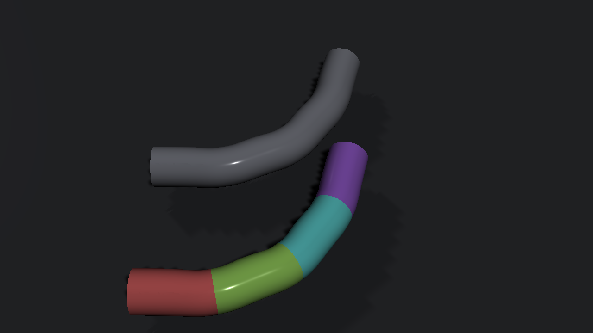
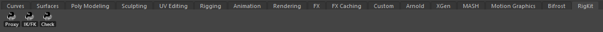

# rig_kit

A small set of rigging tools for Maya: proxy segmentation, IK/FK matching, a rig validator and an mGear wheel component.



## Why

These are the jobs I kept redoing by hand on every character. Animators want a light proxy rig for playback, and cutting one up per joint is tedious. IK/FK snapping breaks the moment a control has a different rotate order or joint orient. And a rig that goes out with a control not zeroed or six influences on a vertex is a rig that comes back.

So there's a proxy builder that cuts a skinned mesh into one piece per joint and constrains them, an IK/FK switcher for two-bone limbs (mGear or anything else, driven by a small YAML file), and a validator that also runs from the command line so it can gate a publish. `wheel_01` is a Shifter component for a wheel that rolls on its own as the vehicle moves. The roll is a node network rather than an expression, so it scrubs properly.

The maths lives in plain Python and is tested without Maya. The `maya_*` modules just read the scene, call it and write the result back.

## Install

Clone the repo and drag `install_rig_kit.py` into the Maya viewport. It writes `rig_kit.mod` to `Documents/maya/modules`, puts `wheel_01` on `MGEAR_SHIFTER_COMPONENT_PATH`, pulls PyYAML into the repo's `deps` folder with Maya's pip if it's missing (stock Maya 2027 doesn't ship it, so you need internet once), and adds a RigKit shelf. It works straight away in the open session.

If you move the folder, drag it in again. To uninstall, delete `rig_kit.mod` and the shelf. There's also a Rez `package.py` if you'd rather go that way.



Proxy builds pieces for the selected skinned meshes. IK/FK switches every limb with a selected control, matching the side you're leaving before flipping the blend, and it copes with referenced rigs. Check validates the scene and prints the full report to the Script Editor.

IK/FK reads `config/limbs_mgear_biped.yaml` by default. For another rig, write your own limb config and set `RIG_KIT_LIMB_CONFIG` to it. Check uses built-in defaults unless `RIG_KIT_VALIDATION_CONFIG` points at a settings file like `config/validation.yaml`.

## Usage

From the Script Editor:

```python
from rig_kit import maya_segment, limb_config, maya_ikfk, maya_export

maya_segment.build_proxies("body_geo", smooth_iterations=2, min_faces=20)

limbs = limb_config.load("config/limbs_mgear_biped.yaml")
maya_ikfk.switch(limbs["arm_L"], key=True)

maya_export.write_json("D:/tmp/hero_rig.json", maya_export.export_rig())
```

Then outside Maya, after `pip install -e .`:

```console
rig-kit validate D:/tmp/hero_rig.json --settings config/validation.yaml
```

It prints a Markdown report (or JSON with `--format json`) and exits non-zero if anything fails. `examples/rig_description.json` is there if you want to try it without Maya.

## Tests

```console
pip install pytest pyyaml numpy
python -m pytest     # everything that doesn't need Maya
mayapy -m pytest     # adds the Maya tests
```

## Limits

IK/FK only handles two-bone chains. Segmentation gives each face to a single joint, so pieces are hard cuts at the joint boundary, not blended. The wheel component's tests check the maths and the file layout but don't load mGear, so the build itself is only tested inside Maya.

## License

MIT
